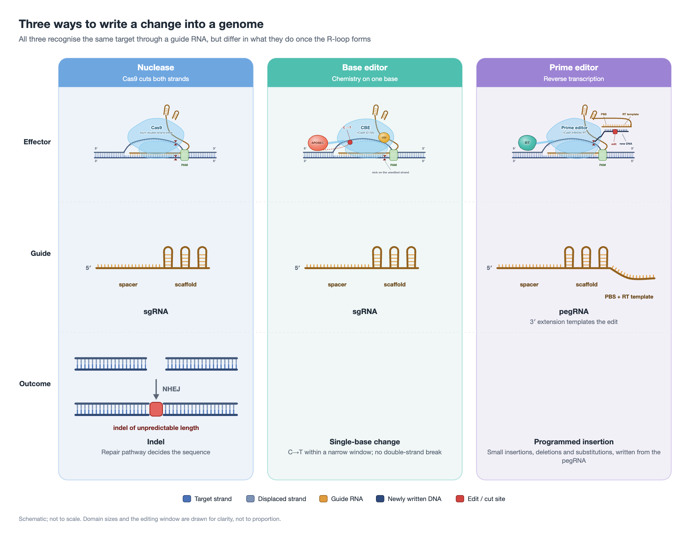
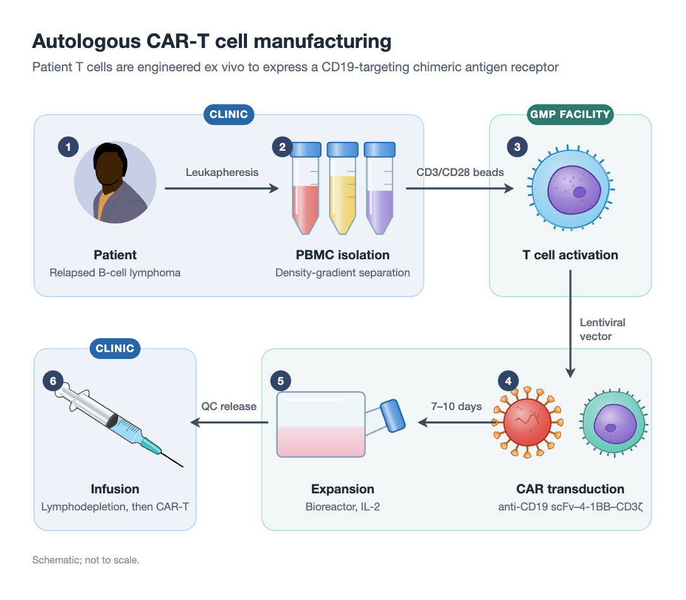
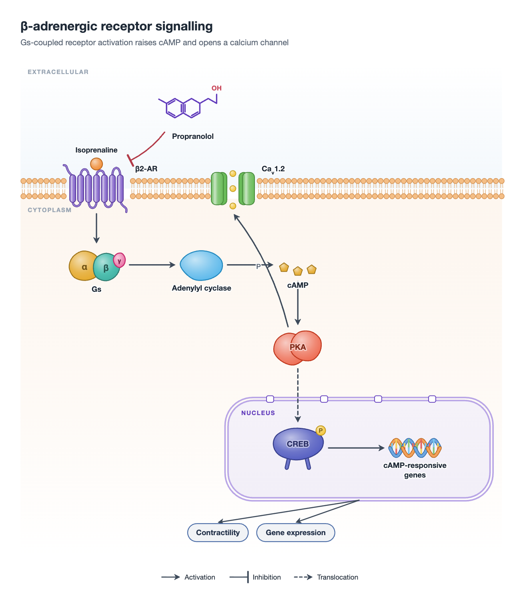
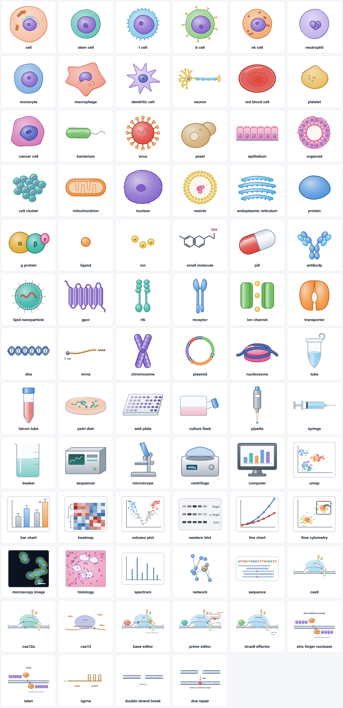
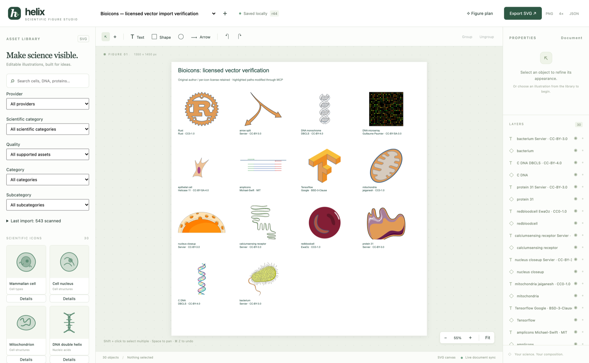
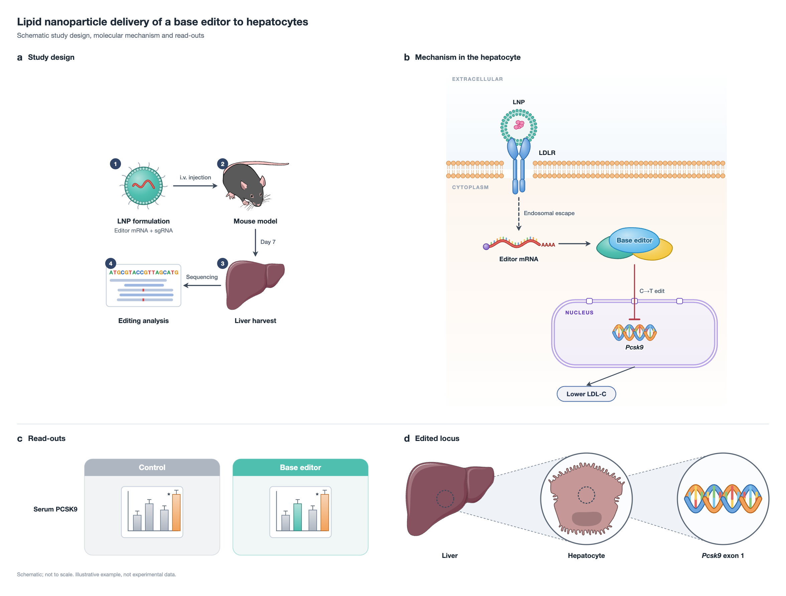

<div align="center">

# Helix

**A scientific figure studio that draws the figure for you.**
Describe the biology; the engine owns every coordinate, illustration, arrow and label.

</div>



<div align="center"><sub>Produced from a single JSON description. No coordinates were written by hand.</sub></div>

---

## The idea

Making a figure by hand means fighting an illustration tool. Making one with an AI assistant usually
means the assistant writing SVG coordinates, which produces exactly the crude, misaligned drawings
you were trying to avoid — it cannot know how wide its own label will render or where an arrow
should stop.

Helix inverts that. You state **what is in the figure**; the engine measures every piece of text,
sizes each panel to its contents, routes the connectors around whatever is in the way, harmonises
the colour and lays out the artboard. The result is a finished vector figure, and every illustration,
label and arrow in it remains a separate editable object.

## Six layouts

| | |
|---|---|
| `workflow` | Protocols and pipelines, including branching ones |
| `pathway` | Signalling mechanisms: membrane, cytoplasmic cascade, nucleus |
| `comparison` | Healthy versus disease, wild type versus knockout |
| `cycle` | Cell cycle, viral life cycle |
| `zoom` | Organism → organ → cell → molecule |
| `panels` | Multi-panel figures, lettered a, b, c |





## Where the drawings come from

**76 procedural glyphs** are drawn by code under one lighting model, so a figure reads as one set
rather than a collage. Each is parametric: colour, variant, modification badges, a label written
inside. Cells, organelles, membrane receptors, nucleic acids, the CRISPR/base-editor/prime-editor
family, lab equipment, and data read-outs such as UMAP, heatmaps, blots and survival curves.



**A licensed illustration library** supplies what procedural code should not invent — organisms,
organs, tissues, specialised cell types — drawn from NIH BioArt, Bioicons/Servier, Reactome, Togo
and SciDraw. A plain name takes the library's illustration when the match is unambiguous and the
asset is genuinely detailed, and the procedural glyph otherwise, so you never get a three-shape
silhouette where a real drawing exists.

The library is **not** distributed with this repository; the import scripts fetch it from each
provider under that provider's own licence. See [NOTICE](NOTICE).

## Everything stays editable



A generated figure opens in the editor as individual objects. Move them, recolour an illustration
path by path in Element Mode, add your own, and export vector SVG or high-resolution PNG. Edits made
by hand and edits made through the MCP tools go through the same document engine, so an assistant
and a person can work on the same figure.

## Multi-panel figures



## Quick start

Requires **Node.js 24**.

```sh
git clone https://github.com/ArdaOdabas/helix.git
cd helix
npm install
npm test
npm run dev
```

Then open <http://127.0.0.1:5173>. To build the standalone macOS application, see
[docs/DESKTOP.md](docs/DESKTOP.md). To connect an AI assistant, see
[MCP setup](#mcp-setup). The engine itself is described in
[docs/FIGURE-ENGINE.md](docs/FIGURE-ENGINE.md).

---

## Driving the engine from an assistant

`generate_figure` takes the specification and returns a preview image for the assistant to inspect,
high-resolution SVG and PNG files, and an editable Helix document with one object per element.
`replaceDocumentId` updates a previous figure in place, which is how an assistant iterates: write a
spec, look at the result, fix the wording or the colours, call again. Companion tools: `find_visual`
previews what a name resolves to, `list_figure_vocabulary` returns every layout, glyph, colour and
example spec.

See [docs/FIGURE-ENGINE.md](docs/FIGURE-ENGINE.md) and the specs in
[examples/engine/](examples/engine/). Helix.app ships the engine, so connecting the app
(**Helix → Connect AI Assistants…**) is all an assistant needs. To drive a development checkout
instead, use [examples/claude-desktop-config.json](examples/claude-desktop-config.json):
`src/mcp/dev-main.ts` starts the document service itself, so no terminal is needed. Enable one or the
other, not both — the tool sets are identical and a figure lands in whichever data directory answered.

## Composing figures without coordinates

`compose_layout` builds a whole publication-style figure from structure alone: panels and the blocks inside them (`track`, `icon`, `note`, `chips`, `inset`, `spacer`). The engine measures text, wraps labels, stacks blocks, sizes panels to their content and aligns connectors, so nothing is hand-placed. `add_primitives` draws the same parametric pieces — panel cards, genomic tracks with homology arms and cut sites, callout insets, typed connectors, brackets and legends — into an existing figure. `harmonize_asset` (and the `hue` / `iconHue` options) recolours imported illustrations onto one figure palette while keeping their internal lightness order, so assets from different providers read as one set. Everything stays editable. See [examples/aavs1-knockin-spec.json](examples/aavs1-knockin-spec.json) and [docs/ROADMAP-FIGURE-INTELLIGENCE.md](docs/ROADMAP-FIGURE-INTELLIGENCE.md).

## macOS app (Helix.app)

Helix now ships as a standalone Apple Silicon app. It needs no terminal, Node.js or Chrome, and it bundles the full scientific library. Build it with `npm run desktop:build` (add `--dmg` via `npm run desktop:dmg` for an installer). Connect AI assistants from **Helix → Connect AI Assistants…**. Architecture, the Electron-vs-Tauri decision, MCP onboarding, signing/notarization and verified test results are in [docs/DESKTOP.md](docs/DESKTOP.md). The plan for mechanism-aware figure generation is in [docs/ROADMAP-FIGURE-INTELLIGENCE.md](docs/ROADMAP-FIGURE-INTELLIGENCE.md).

The development workflow below still works unchanged and uses its own `data/` directory.

## Install and start

Requires **Node.js 24** and npm. On this machine Node 24 is `/opt/homebrew/opt/node@24/bin/node`; the default shell's `node` is Node 18. Select Node 24 first:

```sh
cd ~/Desktop/scientific-figure-editor
export PATH="/opt/homebrew/opt/node@24/bin:$PATH"
node --version
npm install
npm test
npm run build
npm run dev
```

Once startup succeeds, open **http://127.0.0.1:5173**. The shared document service runs at **http://127.0.0.1:4317**. `npm run dev` starts both processes and stops both on Ctrl+C. `npm run server` runs only the document service and serves `dist` after a successful production build. Neither process binds publicly. For production-preview mode, open port 4317 rather than Vite's port.

The current environment could not download missing packages or bind a local listening socket. These commands must be rerun after those restrictions are removed. A full dependency lockfile has not yet been generated. Cached SDK/parser packages were used for offline checks; the installation command above installs declared dependencies normally.

## Use the editor

- Click a library icon to insert an SVG instance; search by scientific names or tags.
- Add text, rectangular/rounded/elliptical shapes, and arrows from the toolbar.
- Click an object; drag to move. Shift-click adds/removes selections. Drag the lower-right selection handle to resize; Shift constrains proportions.
- Groups are selected as a unit on the canvas. Alt-click accesses a nested object; layers can select individual descendants. Double-click text opens text editing, and the properties panel edits text and geometry directly.
- Use the Layers list to select, hide, and lock. Use Bring front/Send back for stacking. Select siblings and Group; Ungroup preserves placement.
- Pan with the pan tool, middle drag, Space-drag, or trackpad scroll. Ctrl/Cmd-wheel zooms around the pointer. Zoom buttons and Fit are also available.
- Use Rotation in Properties, or edit an affine matrix through MCP. Canvas rotation handles are not implemented.
- Undo/redo use buttons or Cmd/Ctrl-Z and Cmd/Ctrl-Shift-Z. One drag is one undo transaction. Delete/Backspace deletes selection.
- SVG export remains vector. Browser PNG export rasterizes at 2× document dimensions. JSON download retains editable objects and references imported asset IDs.
- Changing documents uses the title dropdown. The plus button creates a blank document.

Manual edits and MCP edits use the same service and engine. The UI polls saved revisions every 1.1 seconds when idle. Stale UI mutations receive a revision conflict rather than overwriting newer work. This MVP has no real-time multi-user merge or authentication; it is a local workstation application.

## Demo and structured generation

On first startup with an empty data directory the service creates the PRBJN example automatically. The persistent copy is also included as `examples/prbjn-document.json`, and the canonical source plan is `examples/prbjn-plan.json`. `examples/prbjn.svg` is a standalone vector rendering.

The requested schematic shows:

```
Human naive pluripotent stem cells
          | PRBJN treatment
          v
     8-cell-like cells
          v
     TPRX1 expression
```

The eight illustrated cells are symbolic and do not imply embryo identity. This is the user-specified conceptual pathway, not validation of PRBJN composition, timing, causality, or a scientific protocol.

The **Figure plan** dialog accepts structured JSON written by a person, Claude, or Codex. `create_document` also accepts `plan`; `apply_figure_plan` replaces an existing figure in one undoable transaction. No external AI API is called. Panels, entities, relationships, labels, layout direction/gap/padding, and style are validated. The planner uses stable topological ordering and deterministic positions. Cycles and invalid references are rejected. It is a simple sequential/DAG layout, not a general constraint solver or automatic scientific fact checker.

## MCP setup

Keep the document service running before using MCP. The stdio server is independent of the browser and does not require a tab to be open. It proxies validated tool calls to the local persistent service; it never writes document files independently.

Examples to merge manually (no existing configuration was modified):

- [Codex configuration](examples/codex-config.toml)
- [Claude Desktop configuration](examples/claude-desktop-config.json)

Use your actual absolute Node 24 and project paths on other machines. Restart the relevant MCP client after adding the example. `npm run mcp` can start the stdio process, but an interactive terminal is not itself an MCP client. All stdout is reserved for the protocol; runtime errors go to stderr.

Implemented tools:

`generate_figure`, `find_visual`, `list_figure_vocabulary`, `create_document`, `get_document`, `search_icons`, `add_icon`, `add_shape`, `add_text`, `add_arrow`, `update_object`, `delete_object`, `group_objects`, `list_objects`, `export_svg`.

Additional tools: `list_documents`, `delete_document`, `ungroup_objects`, `apply_operations`, `apply_figure_plan`, `undo`, `redo`. Asset tools: `get_asset`, `list_categories`, `list_imports`, `recolor_asset`, `list_svg_elements`, `recolor_svg_element`. `search_icons` supports category/subcategory filters.

All inputs use strict Zod schemas. Mutation tools accept `expectedRevision`; supply the revision from `get_document` to prevent overwrites. Invalid object/asset references return errors. `export_svg` returns SVG text for the saved revision; the assistant can save it to a chosen output file.

Suggested assistant instruction:

> Read the icon catalog and create a scientific figure using a structured plan. Use three entities: naive pluripotent stem cells, eight-cell-like cells, and TPRX1 expression. Label the first relationship PRBJN treatment. Pass the plan to create_document, then export_svg. Keep the result editable.

No claim is made that live Claude Desktop or Codex installation has been completed. The SDK client/server contract has been tested in memory; use `npm run test:mcp` for the real stdio-to-service check after service startup.

## Licensed asset importer

Read [ASSET_LIBRARY_UPGRADE.md](docs/ASSET_LIBRARY_UPGRADE.md) for current import commands, optional JSON/CSV metadata, incremental versioning, migration details, UI/MCP features, and limitations.

Read [LICENSED_ASSET_IMPORT.md](docs/LICENSED_ASSET_IMPORT.md) for official transfer options, the manifest format, sanitizer profile, deduplication, metadata, thumbnails, search, scale, and remaining provider steps.

```sh
npm run import:assets -- samples/svg samples/manifest.json
npm run benchmark:assets -- 10000
```

The importer is local-only and does not download anything. The complete licensed BioRender library has not been acquired. It expects a provider-supplied package or another documented transfer agreed with the provider before collection.

## NIH BioArt and MCP element editing

See [the NIH BioArt integration report](reports/bioart/README.md) for official local-download acquisition, provider filtering, ID-based atomic element editing, verified sample imports, supported SVG features, and repeat/resume commands. Existing MCP connections need to reconnect to discover the current 40-tool registry (MCP version 0.7.0).

## AI Figure Composer and visual feedback

The existing structured-plan composer has `compose_figure` (always a new document), `render_figure` (PNG as native MCP image content), `analyze_figure_layout` (read-only browser-measured diagnostics), and `refine_figure_layout` (inspection by default; explicit revision-checked correction in at most three passes). Version 0.5 adds transformed arrow collision/clearance checks, explicit relationship/label ownership, bounded safe label/endpoint corrections, whitespace metrics, opt-in non-cropping artboard resizing and explicit capped/strict PNG scale reporting. Claude/Codex can inspect the PNG, apply existing document commands and render again. Scientific meaning and intentional whitespace remain for the caller to assess. Installed Chrome/Chromium is required; `CHROME_PATH` overrides its executable. See [current schemas and validation](reports/figure-feedback-v2/README.md) and the [original implementation audit](reports/figure-feedback/README.md).

For an **existing document**, use `resize_artboard({documentId,width,height,expectedRevision,preserveContent:true})`. Version 0.5.1 exposes this clearly named wrapper around the existing resize guard and transaction; it never creates a replacement. `preserveContent` defaults true; false explicitly permits viewport clipping while keeping all objects and their coordinates. Read the current revision first, then use Undo/Redo or `render_figure` to inspect the saved dimensions. The older `refine_figure_layout.resizeArtboard` parameter remains compatible. See [actual schemas, live UI verification and limits](reports/resize-artboard/README.md).

See [the collection expansion report](reports/bioart-expansion/README.md) for official gallery discovery, per-entry SVG ZIP downloads, individual Public Domain/Creative Commons licensing, resumable acquisition, current SQLite counts, rejection reasons and isolated validation commands.

## Bioicons integration

The official Bioicons checkout is in `vendor/bioicons`; compatible icons are imported into the existing catalog with individual author/license metadata. See [the import and verification report](reports/bioicons/README.md) for counts, supported features, performance, attribution notices, and exact repeat commands. No BioRender source was used.

## Architecture and storage

```
src/core/     Versioned schemas, affine geometry, commands, SVG compiler, figure plans
src/engine/   Figure engine: procedural glyphs, asset ranking, layouts, spec language
src/assets/   Independent local importer, XML sanitizer, SHA-256 catalog, SQLite FTS
src/server/   Sole document writer, atomic JSON snapshots, persisted undo/redo, HTTP API
src/mcp/      Official SDK server and stdio-to-service adapter
src/ui/       React editor shell, SVG rendering and pointer gestures
samples/      Original local SVG importer fixtures and manifest
examples/     Demo plan/document/export and MCP configuration examples
tests/        Core operations, persistence, plan, sanitizer, importer, MCP contract
```

Default storage is `<project>/data`: `documents/*.json` contains the document and up to 100 undo/redo snapshots; `catalog.sqlite` stores metadata/FTS/provenance; `assets/*.svg` and `thumbnails/*.svg` are content-addressed. Set `FIGURE_DATA_DIR` for the service and pass the same directory to the importer to relocate storage. Back up the whole directory.

The browser never writes persistent files directly. Document-service commands are synchronous and serialized in one process; snapshots use temporary files and atomic rename. Only one service should own a given data directory. Unsupported document schema versions are rejected; no legacy schema migration is claimed.

## Validation

Interactive SVG editing: double-click an icon, or select it and press **Edit SVG Elements**. Click a painted path, or choose a path/group from **SVG Elements** in the inspector. Shift-click paths or list rows to select several; fill/stroke changes apply as one undoable batch. Escape, **Exit Element Mode**, or clicking outside the icon returns to Object Mode. See [Element Mode validation and limitations](reports/element-mode/README.md).

```sh
npm test               # Vitest tests, once dependencies are installed
npm run build          # TypeScript checking and Vite production build
npm run test:mcp       # Actual stdio SDK client against the running service
npm run test:browser   # Installed Chrome, headless, against running Vite
npm run test:elements:browser # Real NIH SVG click/recolor/MCP sync tests, isolated data
npm run test:feedback  # PNG/MCP composer and correction loop, isolated data
npm run test:feedback:v2 # Arrow clearance, whitespace, resize and PNG scale regressions
npm run test:resize:browser # Resizes only the previously owned disposable test document
npm run test:offline   # Same assertion bodies under Node's native test runner
```

`test:offline` is an explicit fallback and does not masquerade as Vitest. Tests cover transform preservation, hierarchy, layer order, invalid references, locks, persisted undo/redo, revision conflicts, deterministic plans, SVG escaping, sanitization, deduplication, thumbnails, pagination, and MCP discovery/calls through the official SDK. Browser automation requires an installed Chrome; `CHROME_PATH` overrides the macOS default.

## Known MVP limitations

- Browser interactions, asset insertion and SVG recoloring are covered by isolated browser smoke tests. See [library expansion validation](reports/library-expansion/README.md) for the current verified results.
- No PDF exporter, arbitrary path editing, freehand drawing, rich-text spans, or dynamic connector anchoring. Plan arrows remain editable geometry but do not automatically follow subsequent object moves.
- Imported fixed SVG colors are preserved; the generic Fill control affects `currentColor`. Use Recolor SVG palette for exact fill/stroke/gradient-stop remapping on an instance. Select individual paths/groups through SVG element in Properties or Alt-click a path; fill/stroke overrides support undo/redo. Path-point editing is not implemented.
- SVG filters, external fonts, embedded images and general CSS stylesheets are rejected; simple class-based paint rules are normalized safely by the importer. Safe masks, markers, and local symbol/use structures are supported. Unsupported assets are reported, not silently flattened.
- Group resizing works through its selection handle; group geometry width/height fields are not meaningful shape dimensions. Rotation numeric fields intentionally expose rotation plus scale, not arbitrary shear editing.
- Local lexical/synonym semantic search is implemented; embeddings and comprehensive ontologies are future work.
- No arbitrary natural-language parser runs inside the application; Claude/Codex provide reasoning and submit a validated plan.
- Official-source acquisition adapters and incremental collection imports are documented in [library expansion](reports/library-expansion/README.md). SciDraw acquisition is paused pending access review. No BioRender assets have been imported.

## Licence

Source code: MIT, see [LICENSE](LICENSE).

The scientific illustration library is **not** distributed with this repository.
`data/` and `vendor/` are excluded; the import scripts fetch each illustration
from its provider, so it reaches you under that provider's own licence. Part of
the library is CC-BY-SA or CC-BY-NC, which is why it is not redistributed here.
[NOTICE](NOTICE) lists every provider, its terms, and the attribution the tool
writes beside each exported figure.

No BioRender code, internal API, schema or scientific asset is included.
